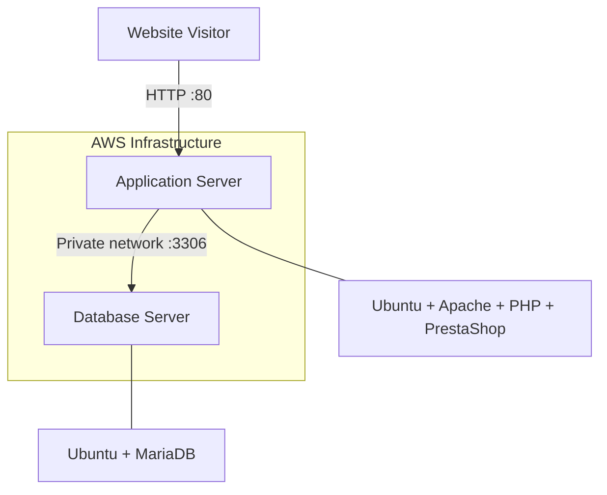

# AWS PrestaShop Architecture Diagram

The diagram below illustrates the two-server deployment.

## Component Responsibilities

- **Website visitor:** Requests the PrestaShop website.
- **Application server:** Processes web requests using Apache, PHP, and PrestaShop.
- **Database server:** Stores application data in MariaDB.
- **Private database connection:** Allows the application server to communicate with the database without exposing the database server directly to the public internet.

## Security Principle

The application and database are separated into distinct servers. Database access should be restricted through AWS security groups to the application server's security group.
